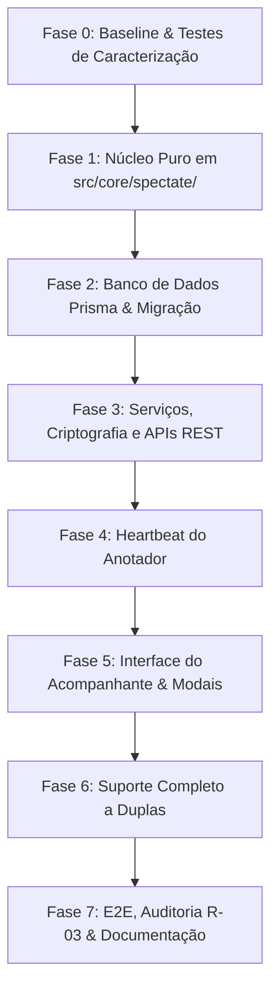

# PLANO DE IMPLEMENTAÇÃO — Acompanhamento de Partidas ao Vivo (Transmissão)

> **Documento de Engenharia & Execução Técnica**  
> **Data:** 2026-10-29  
> **Status:** Aprovado para Implementação  
> **Alvo:** RKT Web / Next.js 15 (App Router) + Prisma + PostgreSQL (Neon) na Vercel Hobby  
> **Diretrizes Base:** `docs/RULES.md`, `docs/ARCHITECTURE.md`, `docs/DESIGN.md`, `docs/TASKS.md`, `docs/MEMORY.md`, `docs/PRD.md`  
> **Restrição R-03:** Rigor absoluto de ≤100 linhas por arquivo de produção. Baseline atual: 0 violações em 992 arquivos (`scripts/r03-baseline.json: {}`).

---

## 1. Visão Geral e Princípios Fundamentais

O módulo de **Acompanhamento de Partidas ao Vivo** permite que acompanhantes autorizados (pais, técnicos, dirigentes e torcedores) acompanhem em tempo real, em modo estritamente **somente-leitura**, o placar e a evolução ponto a ponto de uma partida enquanto o anotador oficial marca os eventos na quadra.

### 1.1 Decisões Arquiteturais Inegociáveis (T1 a T12)

| # | Decisão | Fundamentação Técnica |
|---|---|---|
| **T1** | **Autenticação Obrigatória** | O acompanhante deve estar logado no sistema. Acesso 100% anônimo é vetado por exigência de compliance ECA/LGPD para proteção de dados de atletas menores. |
| **T2** | **Acompanhante ≠ Novo Role** | O enum `Role` (`ADMIN`, `ANNOTATOR`) e `ROLE_HIERARCHY` permanecem intactos. Acompanhante é uma concessão temporária por partida (`MatchSpectator`). |
| **T3** | **Dupla Via de Acesso** | (a) Atores com vínculo direto (`canReadMatch`: atleta participante, responsável legal, treinador seguidor, staff do CT dono) leem nativamente. (b) Terceiros entram via convite pontual gerado pelo criador ou anotador ativo. |
| **T4** | **Leitura Estrita (Zero Escrita)** | O acompanhante nunca grava ou altera o estado de jogo. Nenhuma rota de mutação de partida aceita concessão de acompanhante. |
| **T5** | **Fidelidade à Gravação Concluída** | O espectador vê o ponto somente após confirmação transacional no servidor (`PointLog` persistido). Pontos retidos na fila offline do anotador não existem para o feed. |
| **T6** | **Correção Transparente (Desfazer/Score Edit)** | Pontos anulados (`voidedAt`) disparam alerta explícito de correção (`"Correção do anotador: ponto #N desfeito"`), sem que o ponto simplesmente "suma" de forma confusa. |
| **T7** | **Honestidade de Sinal** | Se o anotador ficar sem conexão (>60s sem heartbeat), a tela exibe *"Sem sinal do anotador desde HH:MM"* e marca o placar como *"último recebido"*. |
| **T8** | **Polling Adaptativo por Ritmo (Opção B)** | Instâncias Serverless na Vercel não compartilham memória. O polling adaptativo respeita o tempo real do jogo (rali em andamento, troca de lado, intervalo de sets), economizando ~80% das chamadas e mantendo a tela informativa durante a ociosidade. |
| **T9** | **Privacidade Absoluta (Lista-Branca)** | Comentários internos (`MatchComment`), áudios (`audioNote Bytes`), notas privadas do anotador e e-mails jamais são incluídos no payload do feed. |
| **T10** | **Proteção de Menores** | Se um participante for menor de idade e o espectador não for seu responsável legal, seu nome é anonimizado via `maskNameForMinor` (ex.: `Gabriel S.` ou `G***`). |
| **T11** | **Respeito aos Limites Vercel Hobby + Neon Free** | Pré-checagem agregada barata (<150 bytes), teto de 5 espectadores por partida, teto de sessão de 3h, pausa com aba oculta (`document.hidden`), parada definitiva em `FINISHED`. |
| **T12** | **Zero Impacto no Baseline R-03** | Nenhum arquivo legado será inflado. Todo código novo nasce modular, coeso e com menos de 100 linhas. |

---

## 2. Correções Prévias Obrigatórias de Bugs Existentes

Antes ou durante a implementação das rotas de transmissão, três correções cirúrgicas em arquivos existentes devem ser aplicadas:

### 2.1 Correção do Redirecionamento de Login com Parâmetro `next`
- **Problema:** [`src/middleware-auth.logic.ts`](file:///c:/apps/RKT/src/middleware-auth.logic.ts#L37) redireciona usuários deslogados para `/login` sem anexar a URL de origem, fazendo com que o convidado perca o convite após autenticar.
- **Solução:**
  1. Em `src/middleware-auth.logic.ts`: quando redirecionar para `/login`, injetar `?next=${encodeURIComponent(pathname + search)}`.
  2. Em `src/app/login/use-login-form.ts` (75L): ler `searchParams.get('next')`, validar se é caminho interno seguro (iniciado com `/` e sem `//`), e redirecionar para ele com `router.push(nextPath)` em vez da home padrão.

### 2.2 Inclusão de `receivedAt` e `updatedAt` em `PointLog`
- **Problema:** Atualmente, `PointLog.timestamp` armazena o horário do cliente (que pode vir atrasado por sincronização offline), e edições de anotações (`PATCH /point/[pointId]`) não alteram `Match.version`.
- **Solução:** Adicionar `PointLog.receivedAt DateTime @default(now())` e `PointLog.updatedAt DateTime @default(now()) @updatedAt`. Isso permite calcular lotes atrasados (`CATCH_UP`) e fingerprints agregados instantâneos.

---

## 3. Modelo de Dados (Prisma)

Nova migração aditiva: `prisma/migrations/20261029090000_add_match_spectating/migration.sql`.

### 3.1 DDL / Schema Prisma
```prisma
// --- prisma/schema.prisma ---

model MatchShareLink {
  id              String           @id @default(cuid())
  matchId         String
  createdByUserId String?
  tokenHash       String           @unique
  label           String?          // Ex.: "Pai do Gabriel"
  createdAt       DateTime         @default(now())
  revokedAt       DateTime?
  lastUsedAt      DateTime?

  match           Match            @relation(fields: [matchId], references: [id], onDelete: Cascade)
  createdByUser   User?            @relation("CreatedShareLinks", fields: [createdByUserId], references: [id], onDelete: SetNull)
  spectators      MatchSpectator[]

  @@index([matchId, revokedAt])
  @@map("match_share_links")
}

model MatchSpectator {
  id        String          @id @default(cuid())
  matchId   String
  userId    String
  linkId    String?
  joinedAt  DateTime        @default(now())
  lastSeenAt DateTime?
  revokedAt DateTime?

  match     Match           @relation(fields: [matchId], references: [id], onDelete: Cascade)
  user      User            @relation("UserSpectators", fields: [userId], references: [id], onDelete: Cascade)
  link      MatchShareLink? @relation(fields: [linkId], references: [id], onDelete: SetNull)

  @@unique([matchId, userId])
  @@index([userId, revokedAt])
  @@map("match_spectators")
}

// Alterações nas tabelas existentes:
// model MatchAnnotationSession {
//   ...
//   lastHeartbeatAt DateTime?
// }

// model PointLog {
//   ...
//   receivedAt DateTime @default(now())
//   updatedAt  DateTime @default(now()) @updatedAt
// }

// enum ConsentPurpose {
//   DATA
//   BROADCAST // Novo valor adicionado com segurança
// }
```

### 3.2 Backfill na Migração SQL
```sql
-- Backfill seguro para linhas existentes
UPDATE "point_logs" SET "receivedAt" = "timestamp" WHERE "receivedAt" IS NULL;
UPDATE "point_logs" SET "updatedAt" = "timestamp" WHERE "updatedAt" IS NULL;
```

---

## 4. Arquitetura de Entrega e Eficiência (Vercel + Neon)

### 4.1 Ciclo de Polling e Pré-Checagem Barata (Passo 0)
Para proteger o limite de **5 GB de egress mensal do Neon** e as **4h de Active CPU da Vercel Hobby**:

```text
[ Cliente (useSpectatorFeed) ]
       |
       | 1. GET /api/spectate/[matchId]/feed?rev=<hashLocal>
       v
[ API Serverless ]
       |
       | 2. Executa Query Agregada Escalar (ultra-leve, < 150 bytes transferidos):
       |    - Match: version, state, updatedAt
       |    - PointLog: count(id), max(sequenceNumber), max(updatedAt)
       |    - MatchAnnotationSession: lastHeartbeatAt
       |
       +--> Fingerprint gerado == rev recebida?
            |
            |-- SIM --> Retorna HTTP 200 { rev, status, signal, nextPollInMs }
            |           (SEM carregar dados de pontos nem view. Custo de banda: ~200 bytes)
            |
            +-- NÃO --> Carrega Match + PointLogs ativos (select estrito, sem audioNote)
                        Gera Projeção toSpectatorView(lista-branca)
                        Retorna HTTP 200 { rev: NovaRev, status, signal, view, nextPollInMs }
```

### 4.2 Polling Adaptativo Inteligente Simplificado (Opção B)
Em vez de um timer fixo e agressivo consultando o servidor a cada 5 segundos, o `useSpectatorFeed` adapta o intervalo ao **ritmo natural de uma partida de tênis**:

1. **Logo após sair um ponto (Ponto em disputa):**
   - Um rali de tênis leva tipicamente entre 10s e 30s. Logo após receber um novo ponto, o cliente agenda o próximo poll para **15 a 20 segundos** depois.
   - Durante esse tempo, a UI exibe: *"🎾 Ponto em disputa..."*. O acompanhante sabe que o jogo está rolando e o cliente não sobrecarrega a rede desnecessariamente.
2. **Intervalo de troca de lado (após game ímpar: 1x0, 2x1, 3x2, etc.):**
   - O tênis impõe intervalo regulamentar de 90 segundos. O polling espaça para **45 a 60 segundos**.
   - A UI exibe: *"🪑 Intervalo: Troca de lado (90s)"*.
3. **Intervalo de fim de set:**
   - O descanso entre sets é de 120 segundos. O polling espaça para **60 a 90 segundos**.
   - A UI exibe: *"⏸️ Fim de set: Intervalo de descanso"*.
4. **Ociosidade / Espera prolongada (> 90s sem ponto marcado):**
   - Se passar mais de 90s sem registro e o anotador estiver ativo, o intervalo se ajusta para **25 a 30 segundos**.
   - A UI exibe: *"⏳ Aguardando próximo saque ou marcação do anotador..."*.
5. **Sem sinal do anotador (> 60s sem heartbeat):**
   - Polling a cada **20 a 30 segundos**.
   - A UI exibe: *"⚠️ Sem sinal do anotador desde as HH:MM. Placar mantido no último recebido."*.
6. **Parada definitiva:**
   - Ao receber `status: 'FINISHED'`, o polling é **encerrado completamente (0s)**.
7. **Pausa em segundo plano (`document.hidden`):**
   - Se o usuário minimizar o navegador ou trocar de aba, o timer de polling é pausado imediatamente. Ao retornar, executa 1 fetch de sincronização instantâneo.
8. **Teto de Sessão e Lotação:**
   - Limite de 5 acompanhantes simultâneos por partida;
   - Desconexão automática após 3 horas ininterruptas (com botão *"Continuar acompanhando"* para retomar).

---

## 5. Contratos de API e Schemas Zod (`src/schemas/spectate.ts`)

### 5.1 Endpoints REST

| Método & Rota | Autorização | Descrição |
|---|---|---|
| `POST /api/matches/[id]/share-links` | Criador ou Anotador Ativo | Gera link de convite e retorna token de uso único |
| `GET /api/matches/[id]/share-links` | Criador ou Anotador Ativo | Lista links criados (tokens mascarados) e acompanhantes |
| `DELETE /api/matches/[id]/share-links/[linkId]` | Criador ou Dono do Link | Revoga o convite e encerra as concessões vinculadas |
| `DELETE /api/matches/[id]/spectators/[userId]` | Criador ou Dono do Link | Remove um acompanhante específico da partida |
| `POST /api/spectate/redeem` | Usuário Autenticado | Resgata o token do convite e grava concessão `MatchSpectator` |
| `GET /api/spectate/[matchId]/feed` | Acompanhante / Vínculo Direto | Retorna feed sincronizado com pré-checagem via `rev` |
| `GET /api/spectate/mine` | Usuário Autenticado | Lista partidas que o usuário está acompanhando |
| `POST /api/matches/[id]/sessions/[sessionId]/heartbeat` | Anotador Ativo da Sessão | Atualiza `lastHeartbeatAt` com throttle de 15s |

### 5.2 Estrutura do Payload `SpectatorFeedResponse`
```typescript
export interface SpectatorFeedResponse {
  rev: string;
  status: 'NOT_STARTED' | 'LIVE' | 'NO_SIGNAL' | 'PAUSED' | 'CATCH_UP' | 'FINISHED';
  serverTime: number;
  nextPollInMs: number;
  signal: {
    lastSignalAt: number | null;
    ageSeconds: number | null;
  };
  catchUp?: {
    count: number;
    from: number;
    to: number;
  };
  view?: SpectatorView; // Presente apenas se rev mudou
}
```

### 5.3 Contrato Estrito de Privacidade (`SpectatorView`)
- **Permitido:**
  - `match`: id, state, format, matchType, startedAt, finishedAt, sides, courtType, category, tournamentName, annotatorName.
  - `score`: sets (games e tiebreak), game atual, indicador de sacador/devolvedor.
  - `points[]`: id, sequenceNumber, setNumber, gameNumber, scoreAfter, winnerSide, serverSide, pointType, isBreakPoint, rallyDetails permitidos.
  - `markers[]`: marcadores de `SCORE_EDIT` e `ARRANGEMENT_CHANGE`.
- **Proibido (Filtrado em `toSpectatorView`):**
  - `MatchComment` (qualquer texto ou áudio);
  - `annotations.note` e anotações livres;
  - `audioNote`, `audioNoteMime`, `audioNoteDuration`;
  - CPFs, e-mails, senhas e identificadores internos dos usuários;
  - `scoreState.history` bruto.

---

## 6. Design System, UX e Componentes Front-End

### 6.1 Wireframe Mobile-First (360px) com Indicador de Ritmo/Ociosidade
```text
┌──────────────────────────────────────────┐
│  RKT                     ● AO VIVO   ☾   │ <- Topo: Marca, Status vivo e Tema
│  Torneio Itamirim · Semi · Quadra 2     │ <- Metadados estruturados
├──────────────────────────────────────────┤
│  Anotando: Carlos M.  ·  Último sinal 8s │ <- Integridade do sinal do anotador
├──────────────────────────────────────────┤
│  Mateus Silva      ●   6   4  │  40      │ <- ScoreboardCard em modo leitura
│  Rafael Lima           3   5  │  30      │ <- Destaque do sacador (●) e game atual
│  Set 2 · Game 10 · Melhor de 3 sets      │
├──────────────────────────────────────────┤
│  ⚡ Último ponto: Ace · Mateus (1º saque) │ <- Faixa viva de atualização imediata
│  🎾 Ponto em disputa (sacando Mateus...) │ <- RITMO / OCIOSIDADE CONTEXTUAL
├──────────────────────────────────────────┤
│  [ Resumo ]    [ Pontos ]    [ Stats ]   │ <- Navegação em abas fluidas
│ ──────────────────────────────────────── │
│  (Aba Pontos aberta)                     │
│  G10  40-30  ● Mateus Silva    Ace       │ <- MatchTimelineView em modo leitura
│  G10  30-30    Rafael Lima     Erro não f│   (sem botões de áudio, edição ou nota)
│  G10  30-15  ● Mateus Silva    Winner FH │
├──────────────────────────────────────────┤
│  ⟳ Próxima verificação em 15s            │ <- Conexão inteligente em repouso
└──────────────────────────────────────────┘
```

### 6.2 Faixa de Ritmo de Jogo e Ociosidade (Contextual na UI)
Abaixo do último ponto marcado, a interface exibe de forma simples, transparente e sem jargões o que está acontecendo na quadra durante o intervalo entre anotações:

1. **`RALLY_IN_PROGRESS` (0 a 30s após o ponto):**
   - *"🎾 Ponto em disputa..."* (indica ao acompanhante que a bola está em jogo; polling relaxa para 15-20s).
2. **`CHANGEOVER_BREAK` (após game ímpar: 1x0, 2x1, 3x2...):**
   - *"🪑 Intervalo: Troca de lado (90s)"* (jogadores no banco; polling relaxa para 45-60s).
3. **`SET_BREAK` (ao fechar um set):**
   - *"⏸️ Intervalo entre sets"* (jogadores em descanso regulamentar de 120s; polling relaxa para 60-90s).
4. **`WAITING_NEXT_POINT` (> 90s sem anotação):**
   - *"⏳ Aguardando próximo saque ou marcação do anotador..."* (polling relaxa para 25-30s).
5. **`NO_SIGNAL` (> 60s sem heartbeat do anotador):**
   - *"⚠️ Sem sinal do anotador desde as HH:MM. Placar mantido no último recebido."*
6. **`PAUSED` (anotador suspendeu a sessão):**
   - *"Anotação pausada temporariamente pelo anotador."*
7. **`FINISHED` (partida finalizada):**
   - *"Partida encerrada"* (polling interrompido em definitivo).
8. **`CLIENT_OFFLINE` (falha na conexão do acompanhante):**
   - *"Você está sem conexão com a internet. Exibindo última atualização."*
9. **`INVITE_INVALID`:**
   - *"Convite não encontrado ou expirado."*
10. **`SPECTATOR_LIMIT`:**
    - *"Esta partida atingiu o limite de 5 acompanhantes simultâneos."*

### 6.3 Acessibilidade e Notificações Dinâmicas (WCAG / `jsx-a11y`)
- Banners de desfazimento (`undo`) e ajuste de placar usam `role="status"` e `aria-live="polite"`.
- O placar não anuncia cada ponto via leitor de tela para evitar sobrecarga auditiva; anuncia apenas viradas de games e fechamento de sets.
- Animações respeitam `prefers-reduced-motion`.

---

## 7. Roteiro de Implementação Fase a Fase



### Fase 0 — Baseline e Blindagem de Segurança
1. Executar `pnpm typecheck` e `pnpm test:strict`.
2. Criar teste de caracterização em `src/core/access/__tests__/visibility.characterization.test.ts` cobrindo todas as variantes de `canReadMatch`.

### Fase 1 — Núcleo Puro (`src/core/spectate/`)
*Arquivos 100% livres de React, Next.js, Prisma ou I/O (cobertura ≥ 95%):*
1. `src/core/spectate/types.ts`: Tipos do feed, estados e projeções.
2. `src/core/spectate/signal-status.ts`: Cálculo determinístico de status e sinal (`LIVE`, `NO_SIGNAL`, etc.).
3. `src/core/spectate/correction-diff.ts`: Detecção pura de desfazimentos de pontos e ajustes manuais de placar.
4. `src/core/spectate/spectator-projection.ts`: Lista-branca estrita e mascaramento de menores via `maskNameForMinor`.
5. Suíte de testes unitários em `src/core/spectate/__tests__/`.

### Fase 2 — Banco de Dados e Migração
1. Atualizar `prisma/schema.prisma` com `MatchShareLink`, `MatchSpectator`, `lastHeartbeatAt`, `PointLog.receivedAt`, `PointLog.updatedAt` e `ConsentPurpose.BROADCAST`.
2. Gerar migração com script SQL compatível e backfill automático.
3. Atualizar mocks e factories de testes.

### Fase 3 — Serviços e APIs REST
1. `src/lib/spectate-token.ts`: Geração de 32 bytes base64url e hash SHA-256.
2. `src/services/spectator.service.ts`: Gestão de convites, concessões, revogações e contagem de lotação.
3. `src/services/spectator-feed.service.ts`: Pré-checagem agregada barata e montagem da timeline via `rebuildTimelineFromPointLogs`.
4. Implementação das rotas REST em `src/app/api/matches/[id]/share-links`, `src/app/api/spectate/redeem`, `src/app/api/spectate/[matchId]/feed`, etc.
5. Atualização de `src/app/api/CONTRACTS.md`.

### Fase 4 — Heartbeat do Anotador
1. Criar o hook isolado `src/hooks/useAnnotatorHeartbeat.ts` (disparo a cada 20s, pausado com aba oculta/offline, throttle no servidor de 15s).
2. Conectar na página de anotação sem inflar arquivos existentes.

### Fase 5 — Telas e Experiência do Usuário
1. Ajustar `src/middleware-auth.logic.ts` e `src/app/login/use-login-form.ts` para preservação segura do parâmetro `next`.
2. Criar página de resgate `src/app/matches/convite/[token]/page.tsx` (resgate com `replaceState` para sumir com token da barra).
3. Criar a tela de acompanhamento `src/app/matches/acompanhar/[matchId]/page.tsx` decomposta em subcomponentes (cada um ≤100 linhas):
   - `SpectatorHeader.tsx`
   - `SpectatorStatusBar.tsx`
   - `SpectatorScoreboard.tsx`
   - `SpectatorLastPointBanner.tsx`
   - `SpectatorCorrectionBanner.tsx`
   - `SpectatorTabs.tsx`
   - `SpectatorTimeline.tsx`
4. Criar modal de compartilhamento `ShareSpectateModal.tsx` no menu do anotador/criador.

### Fase 6 — Compatibilidade com Duplas
1. Projeção de `serverMemberId`, `receiverMemberId`, `courtSide` e `hitterId` nas duplas.
2. Formatação na timeline com identificação de saque e devolução por atleta.

### Fase 7 — Regressão, E2E e Fechamento
1. Teste E2E (Playwright): convite → login → resgate → acompanhamento ao vivo → desfazer de ponto com aviso → encerramento.
2. Validação R-03: `pnpm check:r03` (meta: 0 violações).
3. Testes de acessibilidade e design: `pnpm test:design` e `pnpm test:components`.
4. Atualização documental em `docs/PRD.md`, `docs/ARCHITECTURE.md`, `docs/RULES.md`, `docs/TASKS.md`, `docs/MEMORY.md` e `docs/glossario.md`.

---

## 8. Critérios de Aceite e Definição de Pronto (DoD)

- [ ] Usuário logado resgata o link e acompanha pontos com latência percebida ≤ 5s após gravação no servidor.
- [ ] Pontos desfeitos pelo anotador exibem banner de correção claro e atualizam o placar sem inconsistências.
- [ ] Queda de conexão do anotador resulta em aviso de *"Sem sinal do anotador"* em 60s, sem travar a interface.
- [ ] Queda de conexão do acompanhante exibe banner local de *"Sem conexão"* mantendo os dados anteriores visíveis.
- [ ] Nenhuma informação confidencial (áudio, anotação interna, comentário, e-mail) vaza no payload.
- [ ] Dados de atletas menores são protegidos via anonimização legal para espectadores sem vínculo.
- [ ] Consumo de CPU e banco validado dentro das cotas gratuitas da Vercel Hobby e Neon.
- [ ] 100% dos testes da suíte passando (`pnpm test:strict`, `test:design`, `test:components`, `typecheck`).
- [ ] Zero violações do limite R-03 (todos os arquivos com ≤100 linhas).

