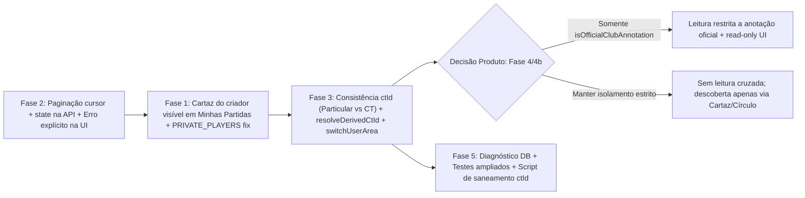

# PLANO DE ANÁLISE E CORREÇÃO DOS FILTROS DE PARTIDAS (RKT)

> **Data:** 2026-11-11  
> **Origem:** Análise crítica do plano externo *"bkpRKT — Plano de correção dos filtros de partidas"* confrontada linha a linha com a base real de `c:\apps\RKT` e com o modelo vigente em [PLANO_ISOLAMENTO_ANOTACOES_POR_ANOTADOR_2026-11-11.md](./PLANO_ISOLAMENTO_ANOTACOES_POR_ANOTADOR_2026-11-11.md).  
> **Status:** Analisado e salvo para revisão/decisão antes da execução (nenhuma alteração de código foi aplicada nesta etapa).

---

## 1. Resumo Executivo da Auditoria

Das **5 causas** apontadas pelo documento de origem, **4 são problemas reais confirmados no código atual**, e **1 (Causa 5 / Fase 4)** entra em **conflito direto** com o isolamento estrito por anotador já implementado neste repositório — além de provocar erro `403 FORBIDDEN` ao clicar nos cards listados caso seja aplicada apenas no filtro de listagem.

| # | Causa apontada (`bkpRKT`) | Veredito em `c:\apps\RKT` | Evidência no código atual |
|---|---|---|---|
| **1** | Escopo Compartilhado/Público cria `isTemplate=true`; lista exclui cartazes | **Confirmada (com ressalva em `PRIVATE_PLAYERS`)** | `buildMatchPayload` gera `isTemplate: true`; `buildMatchListWhere` aplica `isTemplate: false`; `canDiscoverMatchTemplate` em `PRIVATE_PLAYERS` omite `createdByUserId`. |
| **2** | Limite de 20 sem paginação, abas filtram no cliente e `orderBy` sem desempate | **Confirmada** | `PAGINATION_LIMITS.DEFAULT = 20`; `useDashboardData` não usa `cursor`/`state`; `matchRepository.listMatches` ordena só por `createdAt: "desc"`. |
| **3** | Divergência de `ctId` entre criação/derivadas e filtro | **Confirmada (especialmente em derivadas e `switchUserArea`)** | `resolveDerivedCtId` cai em `template.ctId` mesmo quando `explicitCtId === null` (`PARTICULAR`); `switchUserArea` emite token sem `ctId` se `targetCtId` omitido. |
| **4** | Erro HTTP ou timeout vira `[]` silencioso | **Confirmada** | `fetchMatchesEndpoint` retorna `[]` em `!res.ok`, `catch` e `AbortError`, misturando erro de rede com estado vazio. |
| **5** | Treinador e Atleta não veem partidas criadas por outros | **Conflito arquitetural grave** | `canReadMatch` e `checkReportAccess` bloqueiam leitura de anotação alheia (inclusive de outro treinador/pai). Incluir no `listMatches` sem alinhar o acesso gera **`403` ao abrir o card** ou **quebra o isolamento por anotador**. |

---

## 2. Análise Crítica Detalhada (Pontos Confirmados, Lacunas e Riscos)

### 2.1 Fase 1 — Cartaz criado voltar ao Histórico (`Minhas Partidas`) do criador
- **Confirmado:** Em `src/app/dashboard/dashboard-view.logic.ts`, a visão equivalente a "Histórico" é `history` (`/historico`, título **`Minhas Partidas`**). Ao criar partida `"Compartilhada no círculo"` ou `"Pública"`, `useNewMatchSubmissionActions.ts` envia o usuário para `/dashboard`, mas o registro fica fora de `listMatches` porque `isTemplate: true`.
- **Gap confirmado em `PRIVATE_PLAYERS`:** Em `src/core/access/match-event-visibility.ts`, `case 'PRIVATE_PLAYERS'` verifica apenas `actor.athletePlayerId` e `actor.guardianOfPlayerIds` — se o criador não for um dos jogadores (ex.: pai ou anotador), `canDiscoverMatchTemplate` retorna `false` para ele mesmo.
- **Gap confirmado em `listAvailableTemplates`:** Em `src/services/match-available.logic.ts`, `take: limit * 2` busca antes de filtrar `canDiscoverMatchTemplate`, podendo retornar menos que `limit` mesmo havendo cartazes elegíveis no banco.
- **Cuidado obrigatório na UI (`MatchCard`):** Ao exibir `isTemplate === true` em `Minhas Partidas`, o `MatchCard` (`src/components/dashboard/MatchCard.tsx`) **não pode** abrir fluxo de seleção de sacador ou `PATCH /state` diretamente no cartaz (`state-route-guards.logic.ts` bloqueia cartaz). Precisa exibir o selo **"Cartaz"** e ação principal **"Anotar minha versão"** chamando `POST /api/matches/[id]/annotate` (`mode: 'resolve'`) — opcionalmente aproveitando a mesma lógica quando o criador já tem anotação derivada (`myAnnotationId`).

### 2.2 Fase 2 — Paginação, filtro por aba no servidor e erros visíveis
- **Confirmado:**
  - `src/lib/api-pagination.logic.ts` define `DEFAULT: 20, MAX: 100`.
  - `src/app/dashboard/hooks/useDashboardMatches.ts` descarta `nextCursor` da resposta de `GET /api/matches` e `src/app/dashboard/hooks/use-dashboard-matches-filters.ts` filtra `FINISHED`, `IN_PROGRESS` e `SCHEDULED` no cliente apenas sobre os primeiros 20 itens.
  - `src/services/matchRepository.ts` ordena apenas `orderBy: { createdAt: "desc" }`; deve passar para `orderBy: [{ createdAt: "desc" }, { id: "desc" }]`.
- **Ajuste necessário no plano original:**
  - Hoje `useDashboardPageModel` alimenta todas as subvisões (`dashboard`, `history`, `annotated`, `live`, `pending`, `reports`) a partir de uma única instância do hook `useDashboardData`.
  - Se `useDashboardData` enviar `state=FINISHED` apenas para `annotated`/`reports` e voltar para `history`, precisa **rebuscar ou manter cache por aba (`stateKey`)**, senão ao alternar entre abas o cliente exibirá lista filtrada incompleta.
  - `fetchMatchesEndpoint` (`src/app/dashboard/hooks/use-dashboard-matches-fetch.ts`) hoje retorna `DashboardMatchPayload[] | null`. Deve passar a retornar resultado discriminado (`{ ok: true, matches, nextCursor }` | `{ ok: false, error }`), tratando `/api/matches` e `/api/matches/suspended-sessions` de forma independente para que falha em `suspended-sessions` não derrube a lista principal.

### 2.3 Fase 3 — Consistência de `ctId` e troca de contexto
- **Bug real confirmado em `resolveDerivedCtId` (`src/services/match-resolve-payload.logic.ts`):**
  - Hoje: `if (explicitCtId) return explicitCtId;` — quando o usuário está no contexto `PARTICULAR`, `annotate/route.ts` passa `ctId = null`. Como `null` é *falsy*, a função cai na linha seguinte (`if (actor.memberships.some(...)) return template.ctId;`) e **grava `ctId` do clube mesmo com o usuário operando no contexto Particular**.
  - Consequentemente, em `buildMatchListWhere` (`contextId === 'PARTICULAR' -> { ctId: null, createdByUserId }`), essa anotação recém-criada **desaparece imediatamente** da lista do criador.
  - **Correção exata:** distinguir `explicitCtId === null` (contexto `PARTICULAR` explícito -> retornar `null` sempre) de `explicitCtId === undefined` (sem contexto no token -> inferir de `template.ctId` se membro ativo).
- **Bug real confirmado em `switchUserArea` (`src/app/api/auth/area/area-switch.logic.ts`):**
  - Quando `targetCtId` não é informado para `TREINADOR_CLUBE` (ou `GESTOR`), `areas.find(...)` seleciona `matching`, porém o token continua sendo gerado com `targetCtId ?? undefined` (`undefined`), emitindo JWT sem `contextId`. Deve resolver `const resolvedCtId = targetCtId ?? matching.ctId ?? undefined;` (ou recusar quando ausente em área de clube).
- **Atenção em `matches-post.logic.ts` + formulário `/match/new`:**
  - `POST /api/matches` já sobrescreve `input.ctId` quando `user?.contextId` existe (`matches-post.logic.ts:24-26`). Unificar isso em `resolveMatchCtId(user, fallbackCtId)` evita divergência com `/annotate` e `/pool/[templateId]/annotate`.

### 2.4 Fase 4 e Fase 4b — Conflito Direto com o Isolamento por Anotador ⚠️
Esta é a maior discrepância entre o plano proposto e o estado atual do `RKT`:

1. **Quebra de arquitetura / bug `403` garantido se aplicado como descrito:**
   - Em `src/core/access/visibility.ts`, `canReadMatch` permite leitura **exclusivamente** ao dono (`createdByUserId === actor.userId`) e ao `GESTOR` ativo do CT dono (`isOwnerCtGestor`), mantendo `ReadMatchOptions.allowParticipantOfficialRead = false` como gancho futuro.
   - Em `src/app/api/matches/[id]/route-get-access.logic.ts` e `src/app/api/matches/[id]/report/report-access.logic.ts`, clicar em qualquer partida listada exige `canReadMatch(...) === true`.
   - Portanto, se a Fase 4 ampliar `buildMatchListWhere` para que **Treinador** e **Atleta** vejam em seu Histórico **anotações de terceiros** (`createdByUserId !== user.id`):
     - **Cenário A (mantendo `canReadMatch` estrito):** a partida aparece no card do Histórico, mas clicar nela resulta em **`403 FORBIDDEN`** na tela de pontuação/relatório.
     - **Cenário B (relaxando `canReadMatch`):** o Pai B ou outro treinador/atleta volta a ler marcações parciais e privadas de outro anotador — **revertendo o requisito central de isolamento por anotador** definido em `PLANO_ISOLAMENTO_ANOTACOES_POR_ANOTADOR_2026-11-11.md`.
2. **Qual é a conciliação correta entre os dois planos?**
   - **Para anotações comuns (não oficiais):** manter **isolamento absoluto** — cada usuário vê e lê apenas as **suas próprias** anotações (exceto `GESTOR` no painel do clube / escopo `GESTOR`).
   - **Para descoberta de confrontos criados por terceiros (gestor, treinador ou atleta):** exibir como **Cartaz (`isTemplate: true`)** ou via aba **Meu Círculo** (`/partidas-publicas`), com ação **"Anotar minha versão"** (não misturar marcação privada de terceiros na lista pessoal).
   - **Para leitura somente leitura por Treinador do atleta e Atleta envolvido (se desejado agora):** restringir estritamente a **anotações oficiais finalizadas ou designadas pelo clube (`isOfficialClubAnnotation: true`)** ou partidas marcadas pelo próprio treinador quando explicitamente autorizadas (`allowParticipantOfficialRead`), **nunca** expondo anotações paralelas privadas de outros anotadores (`Father B`, outro espectador ou outro treinador avulso). Isso exige decisão explícita de produto antes de executar a Fase 4.
3. **Ajustes sobre `isGestorScope` (`matches-get.logic.ts`):**
   - **Válido e recomendado:** Em `src/app/api/matches/matches-get.logic.ts`, `isGestor` deve exigir `(actor.activeArea ? actor.activeArea === 'GESTOR' : true)` (ou `actor.activeArea === 'GESTOR'`), para que um gestor alternado para área de treinador use escopo de treinador e não puxe todo o CT na aba pessoal.
4. **Impacto da Fase 4b em testes e UX existentes:**
   - `src/components/dashboard/match-card-club-badge.tsx` e `src/components/dashboard/__tests__/MatchCard.club-athlete-badge.test.tsx` hoje testam e exigem explicitamente os rótulos `"Meu Clube"`, `"Meu Atleta"` e `"Por: ..."`. Remover esses selos altera contrato visual e suíte de testes existente (precisa ser feito intencionalmente e atualizar `MatchCard.club-athlete-badge.test.tsx`).
   - Além disso, `MatchCard` atualmente lê `createdByName` em `player1/player2` mapeado em `matches-get.logic.ts` a partir de `player.createdByUser.name` (quem cadastrou o **atleta**), e **não** `match.createdByUser.name` (quem criou a **partida**). Esse diagnóstico do plano `bkpRKT` está **100% correto**.

### 2.5 Fase 5 — RLS, Diagnóstico e Observações Operacionais
- **RLS no Prisma (`src/lib/prisma.ts`):** Confirmado que `src/lib/prisma.ts` cria `PrismaClient` padrão sem `SET LOCAL app.current_user_id`; `runWithRLS` (`src/lib/rls-context-run.logic.ts`) mantém apenas contexto `AsyncLocalStorage` em Node.js. Portanto, no PostgreSQL a `DATABASE_URL` da aplicação precisa realmente operar sem bloqueio pela policy `match_annotator_own` (ou via role com `BYPASSRLS` / `postgres`).
- **Observação operacional do texto original:** A menção no plano do `bkpRKT` a *"Entrega: .zip ... Os testes não rodam aqui"* vem de sessão externa anterior. Neste workspace (`c:\apps\RKT`), toda fase deve ser validada localmente com `pnpm typecheck`, `pnpm test`, `pnpm check:r03` (respeitando limite R-03 de ≤ 100 linhas por arquivo), `pnpm test:design` e `pnpm test:e2e`.

---

## 3. Plano Revisado e Conciliado para Execução

Ordem recomendada preservada (`2 → 1 → 3 → [Decisão 4/4b] → 5`), removendo conflitos de acesso e ajustando aos nomes e contratos reais deste repositório:



### Fase A (antiga Fase 2) — Paginação, filtro no servidor e erros visíveis
1. **`matchRepository.ts`:** alterar ordenação para `orderBy: [{ createdAt: 'desc' }, { id: 'desc' }]` (estabilidade de cursor).
2. **`use-dashboard-matches-fetch.ts`:** substituir retorno `[]` em `!res.ok` / timeout / erro por `{ ok: true, matches, nextCursor }` | `{ ok: false, errorMessage }`.
3. **`useDashboardMatches.ts` e `DashboardViewRouter.tsx`:**
   - Buscar `/api/matches` com `limit=50`, `cursor` e `state` quando a subvisão for específica (`IN_PROGRESS`, `SCHEDULED`, `FINISHED`), mantendo busca paginada completa em `history` (`/historico`).
   - Isolar falha de `/api/matches/suspended-sessions` sem apagar a lista principal.
   - Exibir botão **"Carregar mais"** quando `nextCursor !== null` e estado de erro **"Não foi possível carregar"** com botão **"Tentar de novo"** (só exibir estado vazio quando `ok === true && matches.length === 0`).

### Fase B (antiga Fase 1) — Cartazes (`isTemplate=true`) visíveis no `Minhas Partidas` do criador
1. **`match-repository-where.logic.ts`:** nas condições de escopo do usuário comum/treinador/atleta (exceto `unrestricted`), acrescentar alternativa explícita `{ isTemplate: true, createdByUserId, ...ctxFilter }` para que o próprio criador veja seus cartazes em `Minhas Partidas`.
2. **`match-event-visibility.ts`:** em `case 'PRIVATE_PLAYERS'`, garantir que `template.createdByUserId === actor.userId` também autorize descoberta pelo criador.
3. **`match-available.logic.ts`:** evitar corte prematuro de `take: limit * 2` antes do filtro de descoberta (buscar lote adequado ou iterar até completar `limit`).
4. **`MatchCard.tsx` / `match-card-header.tsx`:**
   - Quando `match.isTemplate || match.isPublicTemplate`: exibir selo **"Cartaz"**, ocultar controles diretos de placar/estado (`Iniciar`, `Retomar`, `Editar Placar`) e exibir botão **"Anotar minha versão"** chamando `POST /api/matches/${match.id}/annotate` (`mode: 'resolve'`).
5. **`useNewMatchSubmissionActions.ts`:** após criar cartaz (`payload.isTemplate`), exibir feedback orientando que o cartaz foi salvo e redirecionar para `toAreaPath('/historico')` (ou oferecer anotação imediata).

### Fase C (antiga Fase 3) — Consistência estrita de `ctId` (`CT` ↔ `PARTICULAR`) e `switchUserArea`
1. **Helper único `resolveMatchCtId(user, fallbackCtId)`:**
   - Se `user.contextId === 'PARTICULAR'` → `null` sempre.
   - Se `user.contextId` preenchido → `user.contextId`.
   - Se ausente → `fallbackCtId ?? null` (para compatibilidade com tokens sem `contextId`).
   - Aplicar em `matches-post.logic.ts`, `match-template-create.logic.ts`, `matches/[id]/annotate/route.ts` e `matches/pool/[templateId]/annotate/route.ts`.
2. **`resolveDerivedCtId` (`match-resolve-payload.logic.ts`):**
   - Diferenciar `explicitCtId === null` (`PARTICULAR` ativo → retorna `null` sem herdar `template.ctId`) de `explicitCtId === undefined`.
3. **`switchUserArea` (`area-switch.logic.ts`):**
   - Passar `matching.ctId ?? targetCtId ?? undefined` ao `generateLoginToken`, e validar obrigatoriedade de CT quando `targetArea` for `TREINADOR_CLUBE` ou `GESTOR`.
4. **Indicador de outro contexto (`otherContextCount`):**
   - Retornar contagem opcional em `GET /api/matches` apenas quando solicitado ou via query leve, exibindo banner discreto `"X partidas em outro contexto"` no topo de `Minhas Partidas` com atalho para troca de contexto.

### Fase D — Círculo Completo + Cartazes não anotados no Histórico (Aprovada)
> **Decisão Consolidada:** O **Cartaz (evento `[12421]`)** pertence ao círculo e é visível a todos os envolvidos (gestor criador, treinador designado, atletas participantes e treinadores particulares que os acompanham) em *Minhas Partidas*. As **Anotações** são 100% isoladas: cada envolvido que clica em *"Anotar minha versão"* cria sua cópia soberana sem misturar pontos, placar ou estatísticas com os demais.

1. **Cartazes do Círculo em `Minhas Partidas` (`buildMatchListWhere`):**
   - Usuário vê no Histórico:
     - (a) Suas próprias anotações (`isTemplate: false, createdByUserId: user.id`);
     - (b) Seus próprios cartazes criados (`isTemplate: true, createdByUserId: user.id`);
     - (c) Cartazes designados para ele anotar (`isTemplate: true, assignedCoachId: user.id`, sem anotação ativa dele);
     - (d) **Cartazes do círculo onde é Atleta Participante ou Treinador de Atleta Participante**, com filtro de não-duplicação:
       ```typescript
       // Cartazes em que o usuário é atleta participante ou treinador de atleta participante
       // exibidos apenas ENQUANTO o usuário ainda não tiver criado anotação derivada:
       annotations: {
         none: {
           createdByUserId: user.id,
           deletedAt: null,
           state: { not: 'CANCELLED' }
         }
       }
       ```
2. **Ampliação do Escopo `canDiscoverMatchTemplate` para Treinadores Particulares:**
   - Em `src/core/access/match-event-visibility.ts`, nos escopos `PRIVATE_CLUB`, `PRIVATE_COACH` e `PRIVATE_PLAYERS`, autorizar descoberta também quando o ator acompanha um dos atletas participantes:
     ```typescript
     if (actor.followedPlayerIds?.some((id) => template.participantPlayerIds.includes(id))) return true;
     ```
   - Isso permite que o Treinador Particular B (do Atleta Y) descubra e anote o cartaz criado pelo Gestor A do Clube A sem tomar `403 FORBIDDEN`.
3. **Escopo de Gestor por Área Ativa:**
   - Em `src/app/api/matches/matches-get.logic.ts`, exigir `actor.activeArea === 'GESTOR'` (ou `actor.activeContextId !== 'PARTICULAR'`) para preencher `ctMemberUserIds`, impedindo que o gestor veja todo o CT quando alternado para sua área pessoal ou de treinador.
4. **Metadados de Criador da Partida (Fase 4b):**
   - Corrigir `BASE_MATCH_SELECT` e `matches-get.logic.ts` para incluir `createdByUser { id, name }` da própria `Match` (e `ct { id, name }`), garantindo que o autor da partida seja identificado corretamente (em vez de usar o criador do cadastro do atleta).
5. **Ciclo de Vida no Card (`MatchCard`):**
   - Enquanto for Cartaz: exibe selo **"Cartaz"** e botão **"Anotar minha versão"** (chamando `POST /api/matches/[id]/annotate`).
   - Após clicar: cria derivada exclusiva do usuário, o Cartaz desaparece do histórico desse usuário e dá lugar à **sua anotação** (com controles de placar e estado `IN_PROGRESS`/`FINISHED`).

### Fase E (antiga Fase 5) — Diagnóstico em banco, saneamento e testes
1. **Diagnóstico read-only no PostgreSQL local (`racket_mvp`):** levantar distribuição de `Match` por `isTemplate`, `isPublicTemplate`, `eventScope`, `ctId`, `sourceMatchId`, `assignedCoachId`, `state`, `deletedAt` e verificar role/RLS da conexão.
2. **Script de saneamento idempotente (após revisão do diagnóstico):** corrigir apenas registros com `ctId` divergente comprovada.
3. **Suite de testes ampliada (`pnpm test` + `pnpm test:e2e`):**
   - `matchRepository.scope.test.ts`: cobrir `PARTICULAR`, `CT`, `isTemplate=true` do criador, `assignedCoachId`, `activeArea === 'GESTOR'` vs `TREINADOR_CLUBE`.
   - `useDashboardMatches.test.tsx`: HTTP `500`, timeout (`AbortError`), `nextCursor` + `"Carregar mais"`, independência de `/api/matches/suspended-sessions`.
   - `match-resolve-payload.test.ts`: `resolveDerivedCtId` no contexto `PARTICULAR` (`explicitCtId = null`) anotando cartaz de um CT.
   - `pnpm typecheck`, `pnpm check:r03` (todos os arquivos novos/editados `<= 100` linhas), `pnpm test:design`, `pnpm test:e2e`.

