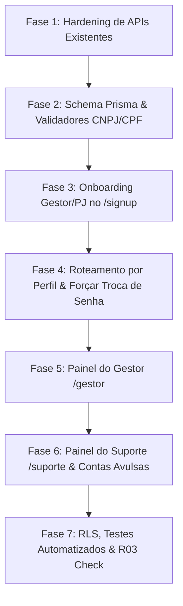

# Plano de Implementação: Cadastro de Gestor, Onboarding de PJ, Painel do Gestor e Painel de Suporte

**Data:** 26/10/2026  
**Status:** Planejado / Aprovado para Execução  
**Documentos de Referência:** `docs/PRD.md`, `docs/ARCHITECTURE.md`, `docs/RULES.md`

---

## 1. Premissas e Decisões Fechadas

| Tópico | Decisão Aprovada | Impacto Técnico |
|---|---|---|
| **Aprovação do Clube** | Novo CT entra como `PENDING` até o Suporte aprovar. | Gestor loga, mas vê tela de aguardando aprovação caso seu CT esteja `PENDING`. |
| **Pessoa Jurídica & Responsável** | Passo 1: Dados PJ / Representante Legal. Passo 2: Responsável pelo sistema com checkbox "Mesmo do representante legal". | Formulário multi-etapas com espelhamento reativo de dados no frontend. |
| **Credenciais de Treinador/Atleta** | Login por CPF, senha provisória `DDMMAAAA` (data de nascimento), troca obrigatória no 1º acesso. | Campos `mustChangePassword` e `tempPasswordExpiresAt` (7 dias) na tabela `User`. |
| **Link de Acesso Único** | Link de primeiro acesso/redefinição com validade de 7 dias, uso único, regerável a qualquer momento. | Reutilização de `PasswordResetRequest` vinculado ao usuário. |
| **CPF & Contas** | CPF sempre obrigatório para Atleta e Treinador. Todo atleta possui conta vinculada (`User` + `Player`). | Criação atômica de `User`, `Player` e `PlayerCT`. Bloqueio de duplicidade com instrução de convite. |
| **Limitação de Gestor** | 1 Gestor gerencia 1 Clube/CT inicialmente. | Restrição de cardinalidade 1:1 na criação pelo onboarding. |
| **Espectador** | Mantém `canOperate: true` (anota partidas próprias), mas consulta estrita restrita às partidas que criou. | Filtro de escopo em `matches-get.logic.ts`. Usuários existentes permanecem inalterados. |

---

## 2. Fase 1: Remediação de Segurança e Hardening Pré-Requisitos

Antes de expor dados sensíveis de PJ (CNPJ) e novos papéis, fechamos as brechas identificadas:

1. **Proteção de `GET /api/users`:**
   - Adicionar guarda `withAccessHandler`.
   - Limitar listagem apenas a usuários com permissão administrativa (`PLATAFORMA:ADMIN` ou `PLATAFORMA:SUPORTE`).
2. **Isolamento de Tenant em `GET` e `POST /api/cts/[id]/athletes`:**
   - Adicionar verificação de contexto: o usuário autenticado deve ser `GESTOR` do CT em questão ou `SUPORTE`/`ADMIN`.
   - Impedir que gestores vinculem atletas a CTs de terceiros.
3. **Correção de Papel em `/api/invites/accept`:**
   - Corrigir a lógica de conversão de `InviteKind`: convite de atleta deve gerar `PlayerCT`, e convite de gestor deve gerar `Membership` `GESTOR` (atualmente tudo que não era treinador virava gestor).
4. **Proteção de Dados Cadastrais em `GET /api/training-centers`:**
   - Usuários com `report:view` recebem apenas projeção pública (`id`, `name`, `slug`).
   - Dados completos de PJ (CNPJ, razão social, telefone) são expostos exclusivamente para o `GESTOR` daquele CT ou para `SUPORTE`/`ADMIN`.
5. **Escopo de Leitura de Partidas para Espectador:**
   - Auditar `matches-get.logic.ts` para garantir que usuários sem CT nem vínculo de treinador visualizem unicamente partidas com `createdByUserId = session.userId`.

---

## 3. Fase 2: Modelagem de Dados e Validações

### 3.1 Alterações no Banco de Dados (`schema.prisma`)

1. **Extensão do modelo `TrainingCenter`:**
   - `cnpj`: `String? @unique` (14 dígitos numéricos normalizados).
   - `legalName`: `String?` (Razão Social).
   - `phone`: `String?`
   - `email`: `String?`
   - `address`: `Json?` (rua, número, complemento, bairro, cidade, estado, CEP).
   - `legalRepName`: `String?` (Nome do Representante Legal).
   - `legalRepCpf`: `String?` (CPF do Representante Legal).
   - `legalRepEmail`: `String?`
   - `legalRepPhone`: `String?`
   - `status`: `String @default("PENDING")` (valores: `PENDING`, `ACTIVE`, `SUSPENDED`).
2. **Extensão do modelo `User`:**
   - `mustChangePassword`: `Boolean @default(false)`
   - `tempPasswordExpiresAt`: `DateTime?`
3. **Migração do Banco:**
   - Executar migração aditiva via Prisma (`prisma migrate dev` ou SQL declarativo compatível com Neon).
   - Sem impacto em registros existentes (campos nulos ou com defaults seguros).

### 3.2 Validadores (`src/lib/validators/`)

- Criação de `cnpj.validator.ts`: validação de máscara e dos dois dígitos verificadores (DV).
- Criação de `cpf.validator.ts`: validação algorítmica rigorosa de CPF.
- Schemas Zod:
  - `gestor-signup.schema.ts` (dados da PJ + dados do responsável).
  - `coach-create.schema.ts` (nome, CPF, nascimento, e-mail).
  - `athlete-create.schema.ts` (nome, CPF, nascimento, gênero, lateralidade).

---

## 4. Fase 3: Onboarding de Gestor e Clube (`/signup`)

### 4.1 Interface de Usuário

1. **Seleção de Perfil no `/signup`:**
   - Adicionar o botão/card **"Gestor de Clube / CT"** ao lado de Atleta, Treinador e Espectador.
   - Ao selecionar "Gestor", interceptar o formulário padrão e abrir o fluxo modal de Onboarding PJ.
2. **Modal Multi-Etapas:**
   - **Passo 1: Dados do Clube / Pessoa Jurídica:**
     - CNPJ (com busca de máscara e validação em tempo real).
     - Razão Social e Nome Fantasia (nome do CT).
     - Contato institucional (telefone e e-mail).
     - Endereço completo.
     - Dados do Representante Legal (Nome completo, CPF, e-mail, telefone).
     - Botão "Avançar para Responsável do Sistema".
   - **Passo 2: Conta do Responsável pelo Sistema:**
     - Checkbox destacado: *"O responsável pelo sistema é o mesmo representante legal da PJ"*.
     - Se marcado: copia automaticamente Nome, CPF e E-mail do Passo 1, desabilitando a edição desses campos.
     - Se desmarcado: campos livres para preenchimento de outro responsável.
     - Senha e confirmação de senha.
     - Botão "Concluir Cadastro do Clube".

### 4.2 Endpoint Atômico (`POST /api/auth/signup-gestor`)

- **Controle de Abuso:** Rate limit por IP e checagem de tentativas.
- **Transação Atômica (`prisma.$transaction`):**
  1. Validar unicidade do CNPJ, do CPF do responsável e do E-mail.
  2. Gerar `slug` único para o CT baseado no nome fantasia.
  3. Criar registro `TrainingCenter` com status `PENDING`.
  4. Criar registro `User` com `role: ANNOTATOR`, `canOperate: true`, hash da senha.
  5. Criar `Membership` do tipo `GESTOR` associado ao `ctId` recém-criado.
  6. Gravar `AuditLog` da ação de criação de novo clube.
- Retorno: confirmação com aviso de que o clube está em análise pelo Suporte.

---

## 5. Fase 4: Autenticação, Perfis e Roteamento Inteligente

### 5.1 Atualização de Sessão e `/api/auth/me`

- Enriquecer a resposta do `/api/auth/me` para incluir:
  - Lista de vínculos ativos (`memberships` com `kind`, `ctId` e `status`).
  - Status do CT vinculado (`ctStatus`: `PENDING` | `ACTIVE` | `SUSPENDED`).
  - Flag `mustChangePassword: boolean`.

### 5.2 Middleware e Redirecionamento Pós-Login

1. **Interceptação de Senha Provisória:**
   - Se `mustChangePassword === true`, o usuário só pode acessar `/trocar-senha`. Qualquer outra rota autenticada redireciona para lá.
2. **Roteamento por Perfil:**
   - `PLATAFORMA/ADMIN` $\rightarrow$ `/admin`
   - `PLATAFORMA/SUPORTE` $\rightarrow$ `/suporte`
   - `GESTOR` $\rightarrow$ `/gestor` (se o CT estiver `PENDING`, exibir componente de aviso/aguardo).
   - `TREINADOR`, `ATLETA`, `ESPECTADOR` $\rightarrow$ `/dashboard`

---

## 6. Fase 5: Painel do Gestor (`/gestor`)

Acesso restrito a usuários com `Membership` `GESTOR` ativo em CT aprovado (`status === 'ACTIVE'`).

### 6.1 Estrutura da Página e Estatísticas

- Cabeçalho com o nome do Clube/CT, CNPJ e badge de status.
- Cards de contagem: Total de Treinadores, Total de Atletas Ativos, Partidas Realizadas no CT.
- Abas de navegação: **Treinadores**, **Atletas**, **Dados do Clube**, **Gestores Adicionais**.

### 6.2 Gestão de Treinadores

1. **Listagem:** Tabela com nome, CPF mascarado, e-mail, data de ingresso e status do vínculo.
2. **Ação "Novo Treinador":**
   - Modal com campos: Nome, CPF, Data de Nascimento (`DD/MM/AAAA`), E-mail.
   - Endpoint: `POST /api/gestor/coaches` (escopado ao CT do gestor).
   - Criação da conta `User` com login por CPF e senha provisória `DDMMAAAA`.
   - `mustChangePassword: true`, `tempPasswordExpiresAt: now + 7 dias`.
   - Criação do vínculo `Membership` `TREINADOR` associado ao `ctId`.
   - Criação automática de token em `PasswordResetRequest` (7 dias de validade).
   - Modal de sucesso exibe o link direto de primeiro acesso para o gestor copiar e enviar pelo WhatsApp/e-mail.
3. **Regeneração de Link:**
   - Botão "Gerar novo link de acesso" na linha do treinador (revoga o token anterior e emite novo de 7 dias).

### 6.3 Gestão de Atletas

1. **Listagem:** Tabela com nome, CPF, idade/categoria, status e histórico de jogos.
2. **Ação "Novo Atleta":**
   - Modal com campos: Nome completo, CPF (obrigatório), Data de Nascimento (obrigatória), E-mail (opcional), Gênero, Lateralidade/Golpes.
   - Endpoint: `POST /api/gestor/athletes`.
   - Verificação: se o CPF já existir no banco:
     - Erro amigável: *"Este atleta já possui cadastro no RKT. Deseja enviar um convite de vínculo com seu clube?"*.
     - Opção de disparo de convite via `LinkInvite` tipo `ATLETA`.
   - Se for novo:
     - Transação cria `User` (login CPF, senha provisória `DDMMAAAA`, `mustChangePassword = true`).
     - Cria `Player` com `userId = User.id`.
     - Cria `PlayerCT` vinculando ao `ctId`.
     - Emite `PasswordResetRequest` de 7 dias e exibe modal para cópia do link.
3. **Regeneração de Link:**
   - Botão para regerar link de primeiro acesso a qualquer momento.

### 6.4 Gestão de Outros Gestores

- Botão para convidar co-gestores para o mesmo clube utilizando a infraestrutura existente de `LinkInvite` (`kind: GESTOR`).

---

## 7. Fase 6: Painel do Suporte (`/suporte`)

Acesso restrito ao perfil `PLATAFORMA/SUPORTE` e `ADMIN`.

### 7.1 Script de Provisionamento de Suporte

- Script seguro em `scripts/create-support-user.ts` para criar ou promover o primeiro usuário `SUPORTE` diretamente via CLI/banco, sem depender de endpoints públicos.

### 7.2 Módulo 1: Gestão de Clubes e CTs

- **Filtro de Status:** Abas `Pendentes de Aprovação`, `Ativos`, `Suspensos`.
- **Análise de Cadastro:**
  - Visualização detalhada de dados do CT, CNPJ, Razão Social, endereço e dados do representante legal.
- **Ações:**
  - Botão **"Aprovar Clube"**: altera status para `ACTIVE`, dispara notificação e libera o acesso do gestor ao `/gestor`.
  - Botão **"Suspender Clube"**: congela o acesso do CT e seus membros.
  - Edição de dados cadastrais da PJ em caso de correções solicitadas pelo clube.

### 7.3 Módulo 2: Gestão de Gestores

- Listagem de todos os gestores por clube.
- Ações: suspender gestor individual, trocar representante responsável, e **"Encerrar Todas as Sessões"** (incrementando `sessionVersion` do usuário).

### 7.4 Módulo 3: Gestão de Contas Avulsas (Não Associadas a Clubes)

- **Atletas Avulsos:** Atletas que não possuem nenhum registro em `PlayerCT`. Suporte pode consultar, auditar e vincular manualmente se necessário.
- **Treinadores Avulsos:** Treinadores com `Membership` `TREINADOR` onde `ctId` é nulo.
- **Espectadores Avulsos:** Usuários sem vínculos a CTs e sem perfil esportivo registrado. Suporte audita histórico de anotações e atividades.

---

## 8. Fase 7: Qualidade, RLS, Testes e Conformidade com Diretrizes

### 8.1 Regras de Código (R03 e Separação de Camadas)

- Respeitar estritamente o limite de linhas (< 100 linhas por arquivo conforme `RULES.md` / R03).
- Arquitetura limpa:
  - Rotas Next.js finas (`route.ts`).
  - Lógica pura isolada em `*.logic.ts`.
  - Consultas isoladas em repositórios/queries dedicados.
  - Validações Zod em arquivos schema separados.

### 8.2 RLS no Neon / PostgreSQL (TD-057)

- Revisar e aplicar políticas de Row Level Security para as novas colunas e tabelas de CT e vínculos (`training_centers`, `player_cts`, `memberships`).

### 8.3 Suíte de Testes Automatizados

1. **Testes Unitários:**
   - Validadores de CNPJ e CPF (casos válidos, DVs inválidos, formatos com máscara e sem máscara).
   - Cálculos e formatação da senha provisória `DDMMAAAA`.
   - Lógica de expiração de senha (7 dias) e flag `mustChangePassword`.
2. **Testes de Integração de API:**
   - Cadastro de Gestor (`POST /api/auth/signup-gestor`): validação de CNPJ repetido, criação atômica no banco.
   - Criação de Treinador e Atleta pelo Gestor com checagem de escopo do `ctId`.
   - Aprovação de CT pelo Suporte e bloqueio de acesso de CT `PENDING`.
3. **Testes End-to-End (E2E com Playwright):**
   - Fluxo completo: Cadastro de Gestor $\rightarrow$ Aprovação pelo Suporte $\rightarrow$ Login do Gestor $\rightarrow$ Cadastro de Treinador $\rightarrow$ Primeiro acesso do Treinador com troca obrigatória de senha.

---

## 9. Cronograma de Execução Recomendado

