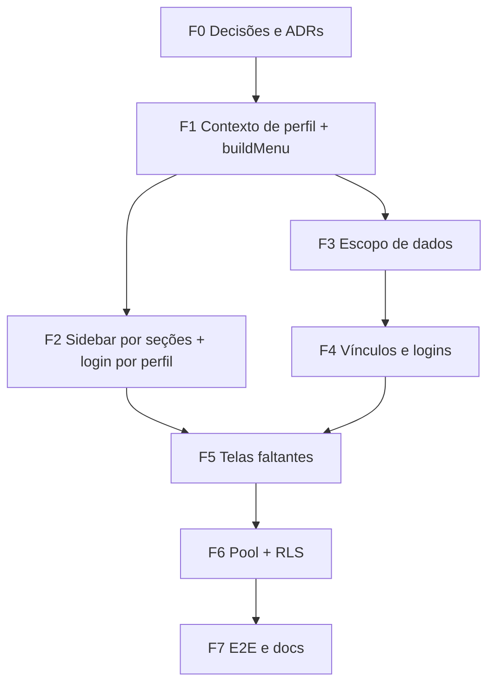

# PLANO DE IMPLEMENTAÇÃO — Menus por Perfil e Pool de Ecossistema (RKT / bkpRKT)

> Documento para um agente de IA implementar a funcionalidade. Data: 2026-10-26.
> Escopo: **menu lateral por perfil/vínculo**, rotas de cada painel, **escopo de dados** (atletas, treinadores, partidas) e **fundação do pool** do ecossistema de tênis.
> Leia antes: `AGENTS.md` → `docs/RULES.md`, `docs/ARCHITECTURE.md`, `docs/DESIGN.md`, `docs/TASKS.md`, `docs/MEMORY.md`, `docs/PLANO_GESTOR_CLUBE_E_SUPORTE_2026-10-26.md`.
> **Este plano não altera código.** Itens marcados **VERIFICAR** não foram confirmados no código durante o planejamento: confirme antes de agir.

---

## 0. Como trabalhar (regras do projeto que valem aqui)

1. **Characterization-First** (RULES §7): antes de alterar `DashboardChrome`, `DashboardSidebar`, `use-login-form` ou `matches-get.logic.ts`, escreva/rode testes `*.characterization.test.ts` que fixem o comportamento atual. Comportamento estranho vira `[TD-XXX]` em `docs/TASKS.md`, sem corrigir fora de escopo.
2. **Baby steps**: mudanças pequenas, `pnpm typecheck` + testes do módulo a cada passo. Ao fim de cada fase: `pnpm test:strict`. Fases de UI: também `pnpm test:design` e `pnpm test:components`. Fim do projeto: `pnpm test:coverage`, `pnpm spec:validate`, `pnpm lint`, `pnpm test:e2e`.
3. **Testes pulados são proibidos** (`scripts/check-no-skipped-tests.mjs`).
4. **Núcleo puro** (`src/core/**`): sem I/O, sem React/Next/Prisma. A regra "quais itens de menu cada conta vê" mora em `src/core/access/menu.ts` (função pura) e é testada isoladamente.
5. **Menu orienta, API protege.** Esconder item de menu nunca substitui `can()` / `withAccessHandler` na rota. Toda tela nova nasce com a API já protegida.
6. **R03**: arquivos com menos de 100 linhas; rotas `route.ts` finas; lógica em `*.logic.ts`; validação Zod em arquivo de schema separado.
7. **UI**: tokens do Telemetry Design System (`telemetry-*`); classes `bg-gray-*`, `bg-sky-*`, `bg-emerald-*` são proibidas em páginas-chave (`test:design`). `jsx-a11y` em `error`; todo botão novo com `aria-label`/texto.
8. **Compatibilidade**: o anotador atual (fluxo `/dashboard`, `/match/new`, scoring) não pode mudar de comportamento. Os testes existentes continuam verdes sem edição.
9. Imports absolutos `@/…`. `strict`, `noUnusedLocals`, `noUnusedParameters` ligados.
10. Documentar ao final: `docs/PRD.md`, `docs/ARCHITECTURE.md`, `docs/glossario.md`, `docs/TASKS.md`, `docs/MEMORY.md`.

---

## 1. Decisões já tomadas (não reabrir)

| Tema | Decisão |
|---|---|
| Natureza do menu | **Por vínculo, não por pessoa.** A conta recebe a **soma das seções** dos vínculos que possui. Item repetido aparece uma vez |
| Acúmulo de perfis | Gestor pode ser treinador e atleta. Treinador pode ser atleta |
| Atleta avulso | Faz **auto cadastro** em `/signup`. Pode criar partidas e cadastrar adversários, como o anotador faz hoje |
| Atleta de clube | Login **criado pelo gestor** (CPF + senha provisória `DDMMAAAA`, troca obrigatória no 1º acesso) |
| Atleta de treinador avulso | O treinador avulso também pode criar o login do atleta |
| Atleta avulso vinculado | Pode se vincular a **treinador e a clube**, e a mais de um de cada |
| Saída de clube | O atleta de clube **só sai quando o gestor desvincula**. Não existe "sair do clube" feito pelo atleta |
| Treinador avulso × atleta de clube | Se o atleta é acompanhado por um treinador avulso, o treinador **pode anotar partidas dele e ver os relatórios** |
| Gestor e partidas | Vê **e anota** as partidas do clube |
| Admin | Mantém o menu atual (item "Admin") |
| Financeiro / Torneios | Aparecem **desabilitados**, com selo "Em breve", até serem desenvolvidos |
| Pool do ecossistema | Atletas, treinadores e partidas pertencem a um **pool global**. Clube/CT é **vínculo e contexto**, nunca dono do dado (ver §3) |
| Suporte | Sem `match:*` na matriz: não vê Nova Partida, Atletas nem Ao Vivo como Suporte |
| "Aguardando" | Sai do menu. É tela de espera aberta pela própria partida (`?matchId=`) |

---

## 2. Estado atual (resumo da análise)

- **Menu único e fixo** em `src/app/dashboard/components/DashboardChrome.tsx`: Início, Histórico, Partidas Anotadas, Ao Vivo, Aguardando, Atletas, Dados Pessoais, Admin (só `role === 'ADMIN'`), Nova Partida, Sair. `DashboardSidebar.tsx` apenas renderiza `{emoji,label,action}[]`.
- **Navegação** em `hooks/useDashboardNavigation.ts` (switch sobre `DashboardView`).
- **`/gestor` e `/suporte`** usam abas internas (`GestorTab`, `SuporteModule`), sem o hambúrguer.
- **Login** (`use-login-form.ts`): só ADMIN → `/admin`; demais → `/dashboard`. O roteamento por perfil do plano de 26/10 ainda não está no login. **VERIFICAR** se algo em `middleware` já faz isso.
- **`Role`** (enum Prisma) só tem `ADMIN | ANNOTATOR`. O perfil real é derivado em `src/core/access/profiles.ts` a partir de `Membership`, `Player.userId`, `GuardianLink` e `canOperate`.
- **`/api/auth/me`** devolve `user`, `memberships` (ativas) e `ctStatus`. **Não devolve** `athletePlayerId`, `PlayerCT` ativos nem seguidos.
- **Pool já existe em parte**: `Player` tem código curto público ("pool global"); `Match.ctId` é opcional (`SetNull`); `PlayerCT` é N:N; `Membership.ctId` nulo = avulso; `Tournament` já existe ligado a CT.

---

## 3. Princípio do Pool (vale para todas as fases)

Objetivo: no futuro o RKT é um **ecossistema de tênis** (clubes, treinadores, atletas, torneios, federações). Para não precisar migrar dados depois:

1. **Identidade é global.** Atleta = `Player` + `User` com **CPF único**. Treinador = `User` com `Membership TREINADOR`. Partida = `Match`. Nenhum deles pertence a um clube.
2. **Clube/CT é vínculo.** `PlayerCT` e `Membership(ctId)` têm `status`, `since` e `endedAt`. **Desvincular encerra o vínculo; nunca apaga** atleta, treinador ou partida.
3. **`Match.ctId` é contexto, não propriedade.** Registra "em nome de qual clube a partida ocorreu". Partida não muda de dono quando o atleta troca de clube. Histórico individual do atleta é sempre completo.
4. **Visibilidade por vínculo ativo**, calculada em `src/core/access/visibility.ts` e `scope.ts`, não por colunas de dono nas tabelas.
5. **Avulso → clube sem perda.** Vincular um atleta avulso a treinador/clube só **adiciona** vínculo. Os dados antigos (partidas, estatísticas) continuam dele.
6. **Sem duplicidade.** CPF único + `platform:player:merge` (Suporte) resolvem duplicatas. Busca de atleta por CPF/código curto antes de criar.
7. **Sem coluna nova de "tenant" agora.** Se o ecossistema exigir (liga, federação), entra como novo tipo de vínculo, no mesmo molde de `Membership`. Registrar como decisão em `docs/ARCHITECTURE.md` (ADR).

> Critério de aceite transversal: nenhuma fase pode introduzir `onDelete: Cascade` de dado esportivo a partir de CT, nem filtro de leitura que dependa de "o CT é dono".

---

## 4. Especificação do menu (fonte de verdade)

### 4.1 Contexto de menu (entrada da função pura)

```
MenuContext = {
  isActive, mustChangePassword, canOperate,
  isAdmin, isSuporte,
  gestor:  { ctIds[], ctStatus } | null,   // Membership GESTOR ativa com CT
  coach:   { ctIds[] } | null,             // ctIds vazio = treinador avulso
  athlete: { playerId, ctIds[], isMinor } | null
}
```

### 4.2 Seções (ordem fixa) e itens

| Ordem | Seção | Aparece quando | Itens |
|---|---|---|---|
| 1 | **Operação** | `canOperate` **ou** qualquer vínculo de atleta, treinador ou gestor (a matriz concede `OPERATE` a todos eles) | Início · Partidas (Nova, Ao Vivo, Histórico, Anotadas) · Atletas |
| 2 | **Atleta** | `atleta != null` | Minhas Estatísticas · Meu Treinador · Meus Clubes (se há `PlayerCT`; senão "Vincular a clube") · Responsáveis (só menor) |
| 3 | **Treinador** | `treinador != null` | Meus Atletas · Solicitações · Relatórios · 🔒 Financeiro |
| 4 | **Gestão do Clube** | `gestorCts` com CT `ACTIVE` | Visão Geral · Treinadores · Atletas do Clube · Logins · Dados do Clube · Co-gestores · 🔒 Torneios · 🔒 Financeiro |
| 5 | **Suporte** | `isSuporte` | Clubes/CTs · Gestores · Contas Avulsas · Solicitações · Auditoria · 🔒 Financeiro |
| 6 | **Admin** | `isAdmin` | Item "Admin" (atual, sem mudança) |
| Rodapé | — | sempre | Dados Pessoais · Tema · Sair |

Regras de composição:
- **Deduplicação por chave de item**, mantendo a **última** seção (a de maior alcance): `financeiro` aparece uma vez mesmo se Treinador, Gestão e Suporte o listarem.
- Quem é **só Suporte** (sem `canOperate`/atleta/treinador) não recebe Operação nem Atleta.
- Gestor com CT `PENDING`/`SUSPENDED`: perde só **Gestão do Clube**; mostra a tela de status em `/gestor`. Demais seções permanecem.
- `mustChangePassword === true`: menu **oculto**, só `/trocar-senha` (já previsto no plano de 26/10).
- Itens 🔒: renderizados desabilitados, `aria-disabled="true"`, selo "Em breve", sem `action`.

### 4.3 Alcance de dados por perfil (itens "Partidas" e "Atletas")

Vale o **maior alcance** entre os vínculos da conta.

| Vínculo | Partidas | Atletas |
|---|---|---|
| Atleta avulso | As que criou ou joga | Os que cadastrou + adversários |
| Atleta de clube | Idem + as do clube em que joga (leitura) | Os que cadastrou |
| Treinador avulso | As que criou + **as dos atletas acompanhados (ver e anotar)** + relatórios | Acompanhados + os que ele criou com login |
| Treinador de clube | Acima + as do CT | Acima + os do CT |
| Gestor | **Todas as do CT: ver e anotar** | Todos os do CT |

### 4.4 Mapa de rotas proposto

| Seção | Rotas |
|---|---|
| Operação | `/dashboard`, `/match/new`, `/partidasaovivo`, `/historico`, `/partidasanotadas`, `/atletas` (existentes) |
| Atleta | `/atleta/estatisticas`, `/atleta/treinador`, `/atleta/clubes`, `/atleta/responsaveis` |
| Treinador | `/treinador/atletas`, `/treinador/solicitacoes`, `/treinador/relatorios` |
| Gestão do Clube | `/gestor` (visão geral), `/gestor/treinadores`, `/gestor/atletas`, `/gestor/logins`, `/gestor/clube`, `/gestor/gestores` |
| Suporte | `/suporte` (clubes), `/suporte/gestores`, `/suporte/avulsos`, `/suporte/solicitacoes`, `/suporte/auditoria` |
| Admin | `/admin` (existente) |

---

## 5. Fases de execução

### Fase 0 — Decisões, ADR e contratos (somente docs)

1. Registrar em `docs/ARCHITECTURE.md` a **ADR do Pool** (§3) e a **ADR "Menu por vínculo"** (§4).
2. Atualizar `docs/PRD.md` com as regras da §1 (saída de clube só pelo gestor; treinador avulso anota partidas de acompanhados).
3. Atualizar `src/app/api/CONTRACTS.md` com os contratos novos listados nas Fases 1 e 4 (antes de implementar).
4. Abrir itens em `docs/TASKS.md` por fase.

**Aceite:** documentação revisada; nenhuma linha de código alterada.

### Fase 1 — Contexto de perfil (backend leve + núcleo puro)

1. **Characterization** de `GET /api/auth/me` (formato atual fixado).
2. Estender `/api/auth/me` de forma **aditiva** (campos novos opcionais): `athlete: { playerId, ctIds[], isMinor } | null`, `coach: { ctIds[] } | null`, `canOperate`, `isSuporte`, `isAdmin`. Nenhum campo existente muda.
3. Criar `src/core/access/menu-context.ts` (tipos) e `src/core/access/menu.ts`:
   - `buildMenu(ctx): MenuSection[]` pura, aplicando §4.2.
   - Itens com `{ key, label, href?, disabled?, badge? }` (sem `action`, sem React).
4. Testes unitários de `buildMenu`: um caso por combinação relevante (§7).

**Aceite:** `pnpm test:strict` verde; `buildMenu` cobre todas as combinações da §7 sem tocar em UI.

### Fase 2 — Menu na interface (sidebar por seções)

1. **Characterization** de `DashboardChrome`/`DashboardSidebar` (menu atual de anotador e de ADMIN).
2. `DashboardSidebar` passa a renderizar **seções** (título + itens), item desabilitado com selo "Em breve". Manter `data-testid="hamburger-menu-button"`.
3. `DashboardChrome` obtém o contexto via `/api/auth/me` (ou `useUserAuth`) e chama `buildMenu`. O menu atual do anotador deve **sair idêntico** (Operação).
4. Remover "Aguardando" do menu (rota permanece).
5. Criar layout compartilhado (`AppShell` ou equivalente) para que `/gestor`, `/suporte`, `/atleta/*`, `/treinador/*` reutilizem topbar + sidebar. **VERIFICAR** como o App Router do projeto organiza layouts (existe `src/app/layout.tsx`; avaliar route group `(app)`).
6. **Login**: `use-login-form.ts` redireciona por perfil principal: Suporte → `/suporte`; Gestor com CT → `/gestor`; Admin → `/admin`; demais → `/dashboard`. `mustChangePassword` → `/trocar-senha`.
7. Admin: item "Admin" preservado como está.

**Aceite:** anotador, ADMIN, gestor, suporte, treinador e atleta veem o menu da §4.2; testes de componente por perfil; `test:design` verde.

### Fase 3 — Escopo de dados (partidas e atletas por vínculo)

1. **Characterization** de `matches-get.logic.ts`, `match-ct-access.logic.ts` e `visibility.ts`.
2. Implementar o alcance da §4.3 em leitura de partidas e atletas, via `scope.ts`/`visibility.ts` (sem coluna de dono nova).
3. **Treinador avulso anota partida de atleta acompanhado**: hoje `match:annotate` é `['ANY']` (OPERATE) e `coach:athlete:view` é `['FOLLOW']`. **VERIFICAR** se `canReadMatch` e a rota de scoring (`/match/[id]/scoring`) permitem a um treinador com `CoachAthleteLink ACTIVE` abrir e anotar partida onde o atleta seguido joga. Se não, ajustar `visibility.ts` e a checagem do scoring.
4. **Gestor anota partida do CT**: garantir que `canReadMatch`/scoring aceitam qualquer partida com `ctId` ∈ CTs do gestor.
5. Relatórios (`report:view`): treinador vê relatórios de partidas dos acompanhados; gestor, dos do CT; atleta, dos próprios.
6. Testes de tenant: usuário de CT A **não** lê dados de CT B; atleta de clube continua vendo o próprio histórico completo mesmo após troca de clube.

**Aceite:** matriz de visibilidade da §4.3 coberta por testes; nenhum vazamento entre CTs.

### Fase 4 — Vínculos e criação de logins

1. **Treinador avulso cria atleta com login**: novo `POST /api/coach/athletes` (ou extensão escopada de `athletes-logic.ts`), reutilizando o fluxo do gestor: `User` + `Player` + `CoachAthleteLink ACTIVE` (sem `PlayerCT`), senha provisória `DDMMAAAA`, `mustChangePassword`, `PasswordResetRequest` de 7 dias. Bloqueio de CPF duplicado com instrução de convite.
2. **Atleta avulso → treinador**: usar `CoachAthleteLink` (`coach-athlete-links` já existe); a conta do atleta aceita/recusa em "Meu Treinador" (`coach:athlete:respond: SELF`).
3. **Atleta avulso → clube**: caminho em que o **próprio atleta** resgata um `LinkInvite ATLETA` (link + código) emitido pelo gestor. Garantir que `/api/invites/accept` cria `PlayerCT` (correção da Fase 1 do plano de 26/10).
4. **Desvínculo só pelo gestor**: `PlayerCT.status = ENDED`, `endedAt = now()`. Não existir endpoint de "sair do clube" para o atleta. Suporte também pode desvincular. **Registrar `AuditLog`**.
5. **Gestor/treinador acumulando papéis**: criar atleta para si mesmo (gestor que joga) reaproveita o mesmo `User` (vincula `Player.userId`), sem segunda conta. **VERIFICAR** o tratamento de CPF existente em `athletes-logic.ts`.
6. Regenerar link de primeiro acesso: gestor (atletas/treinadores do CT) e treinador avulso (atletas que criou).

**Aceite:** os 3 cenários de vínculo da §1 funcionam ponta a ponta; atleta de clube não consegue sair sozinho (teste de API retorna 403/404).

### Fase 5 — Telas faltantes

Cada tela com API já protegida (Fase 4/3) e menos de 100 linhas por arquivo.

1. **Atleta**: `/atleta/estatisticas`, `/atleta/treinador`, `/atleta/clubes` (inclui "Vincular a clube"), `/atleta/responsaveis`.
2. **Treinador**: `/treinador/atletas` (com "Criar atleta com login"), `/treinador/solicitacoes`, `/treinador/relatorios`.
3. **Gestor**: converter abas de `/gestor` em rotas (`/gestor/treinadores`, `/gestor/atletas`, `/gestor/clube`, `/gestor/gestores`) e criar `/gestor/logins` (link novo, quem não trocou senha, suspender).
4. **Suporte**: converter módulos em rotas e criar `/suporte/solicitacoes` (reset de senha, claims, pedidos de acesso) e `/suporte/auditoria`.
5. **Financeiro e Torneios**: **sem tela**; apenas o item desabilitado no menu (Fase 2). Nenhuma rota é criada.

**Aceite:** todos os itens habilitados da §4.2 levam a uma tela funcional; itens 🔒 não navegam.

### Fase 6 — Endurecimento do pool e RLS

1. Revisar RLS (TD-057) para `player_cts`, `memberships`, `coach_athlete_links`, `matches` conforme a visibilidade por vínculo da §3.
2. Auditar `onDelete` das relações esportivas: nenhum dado de atleta/partida some por exclusão de CT. **VERIFICAR** `Match.ct` (`SetNull`, ok) e `PlayerCT` (`Cascade` ao apagar CT: avaliar trocar por bloqueio/soft-delete, pois CT nunca deve ser apagado, só `SUSPENDED`).
3. Busca/dedup: CPF e código curto do pool; fluxo de `merge` de atleta já existente no Suporte.
4. Cenário "atleta troca de clube": vínculo antigo `ENDED`, novo `ACTIVE`, histórico preservado (teste de integração).
5. Registrar pontos de extensão futuros (liga, federação, torneio multi-CT) em `docs/ARCHITECTURE.md`, **sem implementar**.

**Aceite:** testes de isolamento e de preservação de histórico; ADR do Pool atualizada com o resultado da auditoria.

### Fase 7 — Qualidade e documentação

1. E2E (Playwright), um fluxo por perfil:
   - Atleta avulso: auto cadastro → cria partida → vincula treinador → vincula clube por convite.
   - Gestor: cria atleta com login → atleta troca senha → gestor anota partida do CT → gestor desvincula atleta.
   - Treinador avulso: cria atleta com login → anota partida dele → vê relatório.
   - Suporte: aprova CT pendente → gestor passa a ver "Gestão do Clube".
   - Conta multi-perfil (gestor + treinador + atleta): menu com as 4 seções, sem duplicar itens.
2. `pnpm test:coverage`, `pnpm spec:validate`, `pnpm lint`, `pnpm test:e2e`.
3. Atualizar `docs/PRD.md`, `ARCHITECTURE.md`, `glossario.md`, `TASKS.md`, `MEMORY.md`.

---

## 6. Dependências entre fases



F2 e F3 podem andar em paralelo depois da F1. A F5 só começa quando as APIs da F4 existirem.

---

## 7. Casos de teste de `buildMenu` (mínimo)

| # | Conta | Seções esperadas |
|---|---|---|
| 1 | Anotador atual (`canOperate`, sem vínculos) | Operação |
| 2 | ADMIN | Operação (se `canOperate`) + Admin |
| 3 | Suporte puro | Suporte |
| 4 | Gestor, CT `ACTIVE` | Operação + Gestão do Clube |
| 5 | Gestor, CT `PENDING` | Operação (sem Gestão do Clube) |
| 6 | Treinador avulso | Operação + Treinador |
| 7 | Treinador de clube | Operação + Treinador (com contexto do CT) |
| 8 | Atleta avulso | Operação + Atleta ("Vincular a clube") |
| 9 | Atleta de clube | Operação + Atleta ("Meus Clubes") |
| 10 | Atleta menor | Atleta com "Responsáveis" |
| 11 | Gestor + treinador + atleta | Operação + Atleta + Treinador + Gestão (Financeiro uma vez) |
| 12 | Treinador + atleta | Operação + Atleta + Treinador |
| 13 | `mustChangePassword` | Nenhuma (só `/trocar-senha`) |
| 14 | Conta inativa | Nenhuma |

---

## 8. Riscos e pontos de atenção

| Risco | Mitigação |
|---|---|
| Mudar o menu do anotador por engano | Characterization na Fase 2 (menu idêntico para anotador) |
| Treinador anotar partida sem vínculo ativo | Teste negativo: vínculo `PENDING`/`ENDED` não concede acesso |
| Vazamento entre clubes ao ampliar leitura | Testes de tenant na Fase 3 e RLS na Fase 6 |
| Perda de histórico ao trocar de clube | Regra §3.2/§3.3 + teste de integração na Fase 6 |
| Duplicidade de atleta (autocadastro + cadastro do gestor) | CPF único + convite de vínculo + `merge` do Suporte |
| Menu mostrando algo que a API nega | `buildMenu` e `can()` partilham os mesmos dados do contexto; testes de contrato |
| Acúmulo de papéis gerando duas contas | Reuso do `User` pelo CPF (Fase 4, item 5) |

---

## 9. Fora de escopo (deliberado)

- Telas e regras de **Financeiro** e **Torneios** (apenas item desabilitado).
- Ligas, federações e multi-CT em torneio (apenas pontos de extensão documentados).
- Mudança no menu do **Admin**.
- Mudança no fluxo de scoring/anotação além do necessário para o acesso de treinador e gestor.
